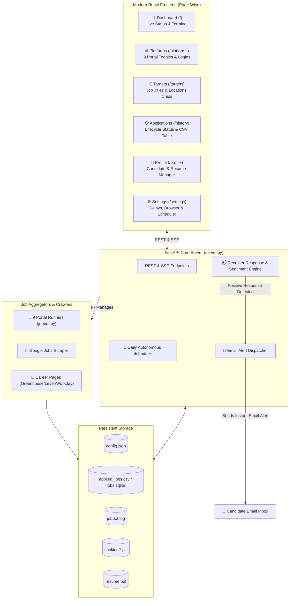
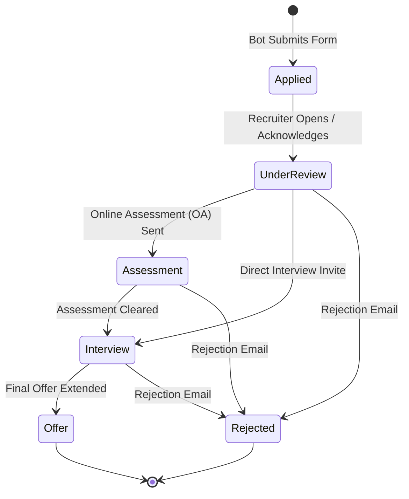
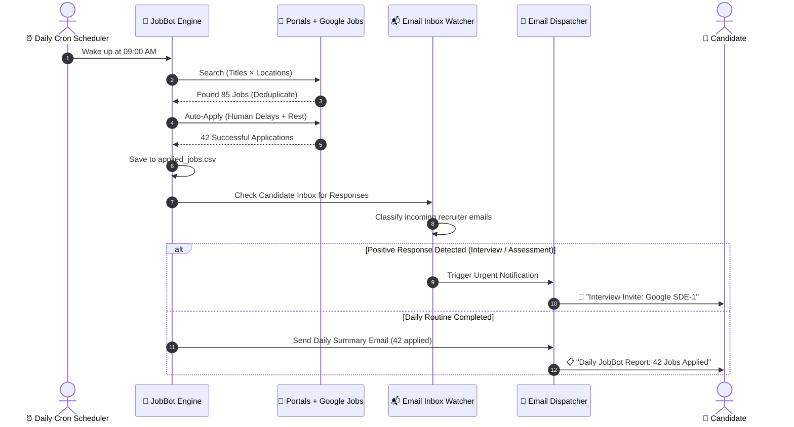

# 🚀 JobBot — Complete Features & Architecture Specification

> **An Autonomous Job Application & Tracking Ecosystem for the Indian Tech Market**  
> Combines automated Selenium application runners across 9 portals, Google Jobs / Career Pages crawler, a Page-wise React Web Dashboard, and an automated Email & Positive Response Tracker.

---

## 📑 Table of Contents
1. [Overview & System Architecture](#-overview--system-architecture)
2. [Current Production Features](#-current-production-features)
   - [Supported Job Platforms (9)](#1-supported-job-platforms-9)
   - [Browser & Anti-Detection Automation](#2-browser--anti-detection-automation)
   - [React Web Dashboard (Page-Wise)](#3-react-web-dashboard-page-wise)
   - [FastAPI Backend Engine](#4-fastapi-backend-engine)
3. [Major New Features](#-major-new-features)
   - [Feature 1: Intelligent Email Notification System](#feature-1-intelligent-email-notification-system)
   - [Feature 2: Job Response & Application Status Lifecycle Tracker](#feature-2-job-response--application-status-lifecycle-tracker)
   - [Feature 3: Google Jobs & Direct Company Career Pages Aggregator](#feature-3-google-jobs--direct-company-career-pages-aggregator)
   - [Feature 4: Daily Autonomous Scheduler & Positive Response Trigger](#feature-4-daily-autonomous-scheduler--positive-response-trigger)
4. [Data Architecture & Configuration Schema](#-data-architecture--configuration-schema)
5. [Workflow & Execution Sequence Diagram](#-workflow--execution-sequence-diagram)

---

## 🏗️ Overview & System Architecture



---

## 🌟 Current Production Features

### 1. Supported Job Platforms (9)
Automates end-to-end job application workflows tailored for the Indian tech market:

| Platform | Mode | Capabilities |
|---|---|---|
| **LinkedIn** | Easy Apply | 1-click apply, answers experience/screening questions, PDF resume upload |
| **Naukri.com** | Direct / 1-Click | India's largest job portal, searches keyword × location, applies to verified recruiters |
| **Indeed India** | Indeed Apply | Automatic cover letter injection, resume attachment, screening answers |
| **Glassdoor** | Easy Apply | Filter by remote/city, submits Glassdoor quick forms |
| **Internshala** | Direct Form | Freshers, internships, and entry-level 2026 graduate roles |
| **Shine.com** | Auto Applier | Automated application submission with user profile synchronization |
| **Foundit (Monster)** | Quick Apply | Candidate session cookie re-use, multi-keyword search |
| **TimesJobs** | Direct | Corporate and enterprise hiring postings |
| **Wellfound (AngelList)**| Pitch & Apply | Startup-focused roles with personalized cover pitch generation |

---

### 2. Browser & Anti-Detection Automation
* **Multi-Browser Auto-Detection:** Automatically locates Microsoft Edge, Google Chrome, or Brave.
* **Persistent Session Reuse:** Saves authentication session cookies into `cookies/*.pkl` to minimize repeated logins and avoid 2FA triggers.
* **Human-like Dynamics:**
  * Random keystroke delays (40ms – 120ms) via `type_human()`.
  * Randomized cooldown delays between individual applications (12s – 25s).
  * Platform rest cycles (10 – 15 minutes) between platform transitions to prevent IP/rate-limit flags.
* **Smart Screening Form Filler:** Auto-fills candidate notice period (0/immediate), current CTC, expected CTC, graduation year (2026), and college degree.
* **Duplicate Prevention:** Tracks every submitted application in `applied_jobs.csv` using unique job IDs to prevent duplicate submissions.

---

### 3. React Web Dashboard (Page-Wise)
Built with React 19, Vite, Tailwind CSS, and Lucide Icons. Every feature is organized into dedicated pages under `frontend/src/pages/`:

* **`DashboardPage` (`/`):**
  * Engine status badge (`IDLE` vs `RUNNING`) with PID and live uptime clock.
  * One-click **Start Bot** and **Stop Bot** actions.
  * Application statistics: Total jobs applied, active platforms, search combos (`Titles × Locations`).
  * Embedded **Live Terminal Viewer**: Real-time Server-Sent Events (SSE) tailing `jobbot.log` with color-coded log levels, auto-scroll toggle, copy to clipboard, and clear controls.
* **`PlatformsPage` (`/platforms`):**
  * Individual cards for all 9 platforms with **Active / Disabled toggle switches**.
  * Email / username and password credentials management with **Show/Hide password** mask.
  * Batch "Enable All" and "Disable All" buttons.
* **`TargetsPage` (`/targets`):**
  * Interactive **Job Titles chip manager** (add, remove, review target roles).
  * Interactive **Locations chip manager** (cities and remote tags).
  * Skills input and expected CTC configuration.
  * **Cover Note Editor** with real-time character count.
* **`HistoryPage` (`/history`):**
  * Interactive data table fed from `applied_jobs.csv`.
  * Real-time search by company, job title, or job ID.
  * Dropdown filter by platform.
  * Direct clickable links to job postings.
  * One-click **Export to CSV**.
* **`ProfilePage` (`/profile`):**
  * Candidate contact and academic details.
  * **Resume Manager:** Shows file presence and size; provides drag-and-drop / click-to-upload for `resume.pdf`.
* **`SettingsPage` (`/settings`):**
  * Browser preference selector (`Auto`, `Edge`, `Chrome`, `Brave`).
  * Headless mode toggle for background running.
  * Delays and anti-ban safety sliders.
  * One-click **Reset Defaults** button.

---

### 4. FastAPI Backend Engine
* High-performance asynchronous REST API running on Uvicorn (`http://localhost:8000`).
* Background process controller: Spawns and kills `jobbot.py` cleanly without blocking the UI.
* Single-command deployment: Serves both the compiled React SPA and REST endpoints simultaneously via `python server.py` or `run_app.bat`.

---

## 🚀 Major New Features

### Feature 1: Intelligent Email Notification System
Sends automated email alerts to the candidate based on job events, execution milestones, and recruiter activities.

#### Capabilities:
1. **Instant Positive Response Alerts:** Triggers immediately when a recruiter invites you for an interview or assessment.
2. **Daily Application Digest:** Summarizes applications submitted today, platform breakdown, and any errors encountered.
3. **Action Required Alerts:** Sends notification if manual intervention is required (e.g., CAPTCHA challenge, session expiration).
4. **Email Providers Supported:**
   * **SMTP (Gmail / Outlook / Custom SMTP):** Zero third-party fees, uses standard app password.
   * **Resend / SendGrid API:** Fast transactional API delivery.

#### Notification Trigger Matrix:
| Event Type | Priority | Channel | Trigger Condition |
|---|---|---|---|
| **Recruiter Interview Invitation** | 🚨 Urgent | Instant Email + Dashboard Toast | Recruiter replies with scheduling link or positive intent |
| **Online Assessment (OA)** | ⚡ High | Instant Email | HackerRank, LeetCode, or test link received |
| **Daily Run Summary** | 📋 Normal | Scheduled Digest (e.g. 8:00 PM) | Daily batch completes |
| **Bot Error / CAPTCHA** | ⚠️ Warning | Instant Email | Bot blocked or manual verification required |

---

### Feature 2: Job Response & Application Status Lifecycle Tracker
Tracks every job from initial submission through offer/rejection, maintaining status updates and timeline records.



#### Capabilities:
* **Recruiter Inbox Synchronization:** Background IMAP / Gmail API listener reads candidate's job inbox to detect recruiter emails matching company name or job title.
* **Lifecycle Status Field:** Extended schema in `applied_jobs.csv` / SQLite:
  * `date`: Application timestamp
  * `platform`: Portal used
  * `job_title`: Target title
  * `company`: Company name
  * `status`: `Applied` | `Under Review` | `OA Received` | `Interview Scheduled` | `Rejected` | `Offer`
  * `last_response_date`: Date of last email from recruiter
  * `notes`: Recruiter details, interview dates, or meeting links
* **Kanban & Table Views in React:** Visual board on the `/history` page allowing candidates to drag and drop or auto-update application statuses.

---

### Feature 3: Google Jobs & Direct Company Career Pages Aggregator
Expands search capability beyond the 9 platforms by crawling Google Jobs and direct company career pages.

#### 1. Google Jobs Aggregator (`Google Search Jobs Scraper`)
* Leverages Google's structured job search results (`https://www.google.com/search?q=jobs+...&ibp=htl;jobs`).
* Queries: `"<job_title>" "<location>" site:jobs OR "apply"`
* Extracts: Job Title, Company, Location, Date Posted, and direct application links (`Apply on company site`, `Apply on LinkedIn`, etc.).
* Bypasses portal walled gardens by discovering hidden postings directly indexed by Google.

#### 2. ATS Direct Career Pages Scraper
Many top tech companies use standardized Applicant Tracking Systems (ATS). The aggregator crawls and applies directly to:
* **Greenhouse (`boards.greenhouse.io/<company>`)**
* **Lever (`jobs.lever.co/<company>`)**
* **Workday (`<company>.myworkdayjobs.com`)**
* **Ashby (`jobs.ashbyhq.com/<company>`)**
* **SmartRecruiters (`jobs.smartrecruiters.com/<company>`)**

#### Benefits:
* Higher conversion rate: Direct company website applications receive significantly higher visibility from hiring managers than aggregator portals.
* No platform application quotas or Easy Apply limits.

---

### Feature 4: Daily Autonomous Scheduler & Positive Response Trigger
Turns JobBot into a fully hands-free autonomous agent running on a recurring schedule.



#### Capabilities:
1. **Flexible Scheduling:**
   * Run every day at specific hours (e.g., 09:30 AM and 05:00 PM).
   * Weekend pause mode (avoids applying outside business hours).
2. **Positive Response Sentiment Classifier:**
   * Analyzes incoming recruiter emails using keyword pattern matching & NLP:
     * **Positive triggers:** `interview`, `schedule a call`, `assessment`, `hackerrank`, `shortlisted`, `next steps`, `congratulations`, `chat with our team`.
     * **Negative triggers:** `not moving forward`, `other candidates`, `unfortunately`, `high volume of applicants`.
3. **Automated Alert Dispatch:**
   * When a positive response is classified, JobBot generates an email with:
     * Company Name & Job Title
     * Recruiter Email & Sender Name
     * Direct link to scheduling / assessment platform (Calendly, HackerRank, Google Meet)
     * Recommended response templates for the candidate

---

### Feature 5: Multi-Provider AI Copywriter & Communication Assistant
Integrated directly into the Settings page and Response Pipeline to draft tailored application notes, recruiter outreach, and email replies.

#### Supported AI Providers:
1. **xAI / Grok (`console.grok.com`)**: `grok-2-latest`, `grok-2-mini`, `grok-beta`
2. **OpenAI**: `gpt-4o-mini`, `gpt-4o`, `gpt-4-turbo`
3. **Anthropic Claude**: `claude-3-5-haiku-20241022`, `claude-3-5-sonnet-20241022`, `claude-3-opus-20240229`
4. **Google Gemini**: `gemini-1.5-flash`, `gemini-1.5-pro`, `gemini-2.0-flash`

#### Capabilities:
* **Tailored Cover Pitch Notes:** Injects candidate background (skills, degree, experience) and target role details to create high-converting cover statements, with 1-click "Save as Active Cover Note".
* **Cold Outreach Messages:** Concise, high-signal LinkedIn or email notes (under 100 words) tailored to recruiters and hiring managers.
* **1-Click Interview & Assessment Replies:** When a recruiter invites you for an interview, click "AI Draft Reply" directly in the Response details modal to draft a polished response confirming scheduling details.
* **Provider Verification:** Includes connection test tool right in the UI to verify API keys and model access.

---

## 📊 Data Architecture & Configuration Schema

All settings are persisted in [`config.json`](file:///d:/sau/Other/JobBot/config.json). The schema supports existing features and new notification/scheduler configurations:

```json
{
  "name": "Rahul Sharma",
  "email": "rahul.sharma@example.com",
  "phone": "9876543210",
  "experience": "1",
  "current_ctc": "0",
  "expected_ctc": "800000",
  "notice_period": "0",
  "college": "ABC Institute of Technology",
  "degree": "B.Tech Computer Science",
  "grad_year": "2026",

  "job_titles": [
    "Full Stack Developer",
    "Software Development Engineer",
    "SDE",
    "React Developer",
    "Backend Developer"
  ],
  "locations": [
    "Bangalore",
    "Hyderabad",
    "Pune",
    "Remote"
  ],
  "skills": "JavaScript, TypeScript, React.js, Next.js, Node.js, Express.js, MongoDB, PostgreSQL, Docker, Git",
  "salary": "8",
  "cover_note": "I am a Full Stack Developer (2026 graduate) with hands-on experience building scalable web applications using the MERN stack...",

  "max_per_platform": 50,
  "delay_min": 12,
  "delay_max": 25,
  "platform_rest_min": 600,
  "platform_rest_max": 900,
  "headless": false,
  "browser": "auto",

  "use_linkedin": true,
  "use_naukri": true,
  "use_indeed": true,
  "use_glassdoor": true,
  "use_internshala": true,
  "use_shine": true,
  "use_foundit": true,
  "use_timesjobs": true,
  "use_wellfound": true,

  "notification_settings": {
    "enabled": true,
    "smtp_server": "smtp.gmail.com",
    "smtp_port": 587,
    "smtp_email": "candidate@gmail.com",
    "smtp_app_password": "xxxx-xxxx-xxxx-xxxx",
    "recipient_email": "candidate@gmail.com",
    "alert_on_interview_invite": true,
    "alert_on_assessment": true,
    "daily_digest": true,
    "daily_digest_time": "20:00"
  },

  "scheduler_settings": {
    "enabled": true,
    "run_times": ["09:30", "17:00"],
    "skip_weekends": false,
    "max_daily_applications": 120
  },

  "crawler_settings": {
    "use_google_jobs": true,
    "use_career_pages": true,
    "ats_targets": ["greenhouse", "lever", "ashby", "workday"]
  }
}
```

---

## 🛠️ Quick Commands

| Action | Command |
|---|---|
| **Start Server & Web UI** | `python server.py` *(or double click `run_app.bat`)* |
| **Open React Dashboard** | `http://localhost:8000` |
| **Direct Bot CLI Mode** | `python jobbot.py` |
| **Build React Bundle** | `cd frontend && npm run build` |
| **Run Frontend Dev Server** | `cd frontend && npm run dev` |
